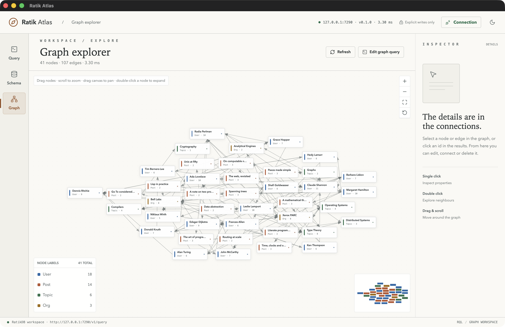
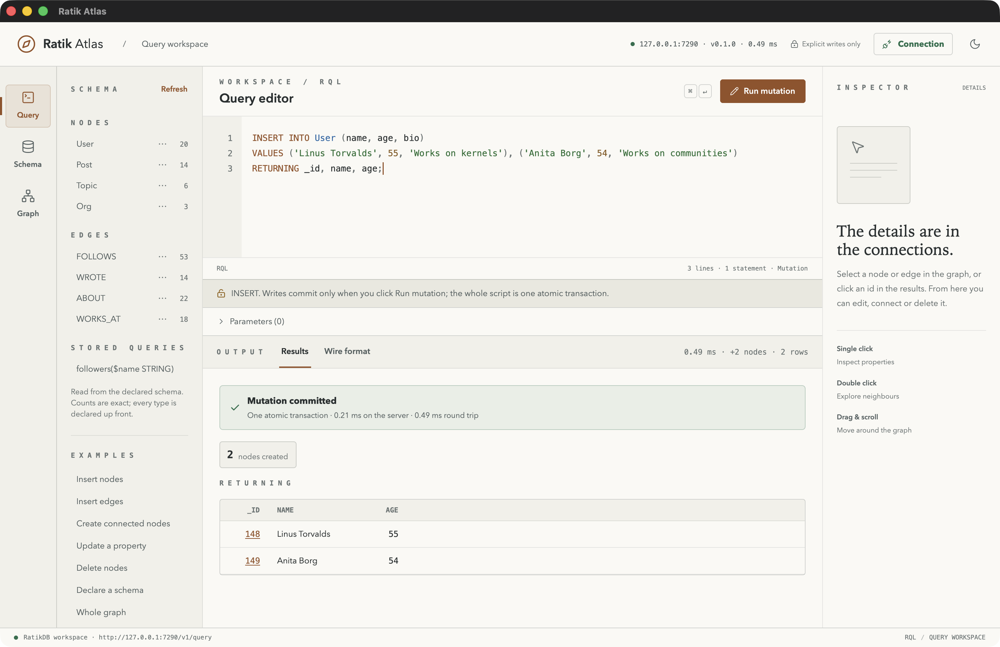
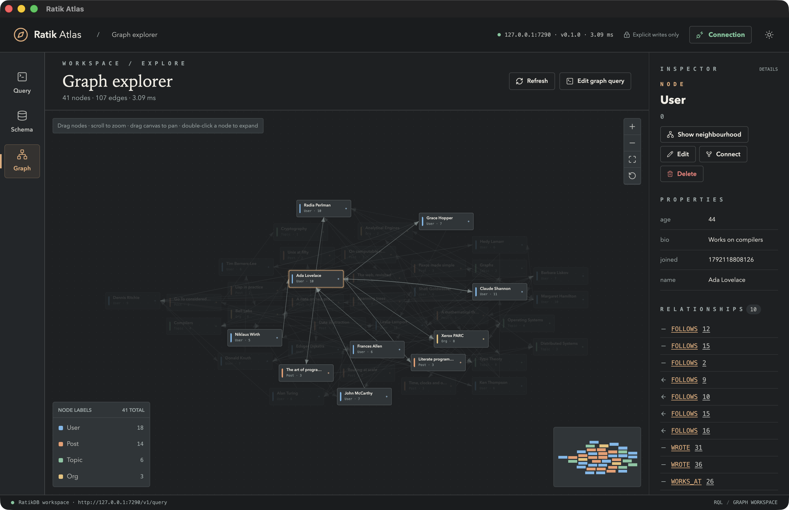
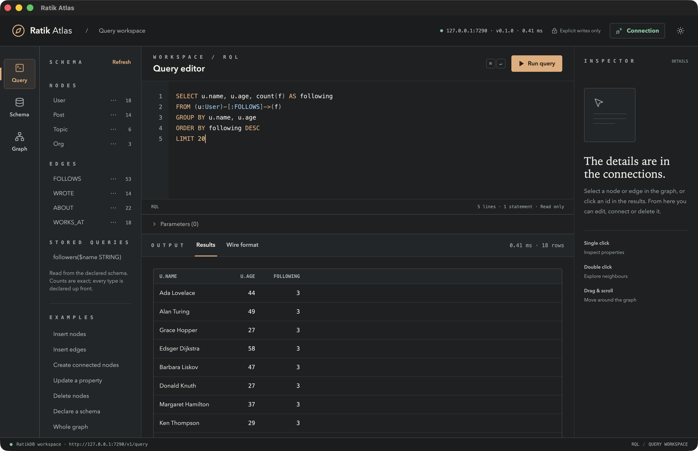
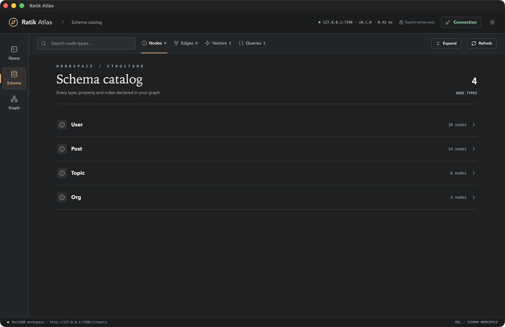
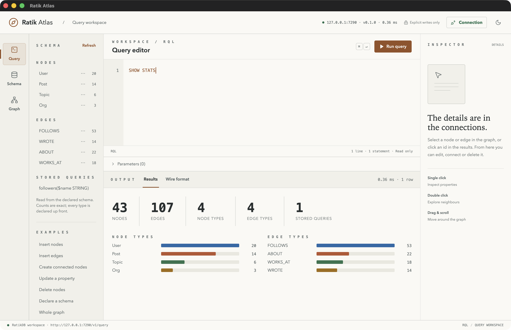
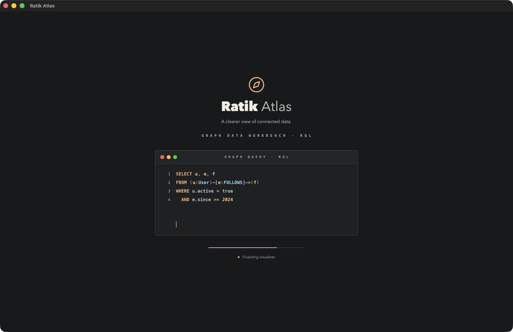
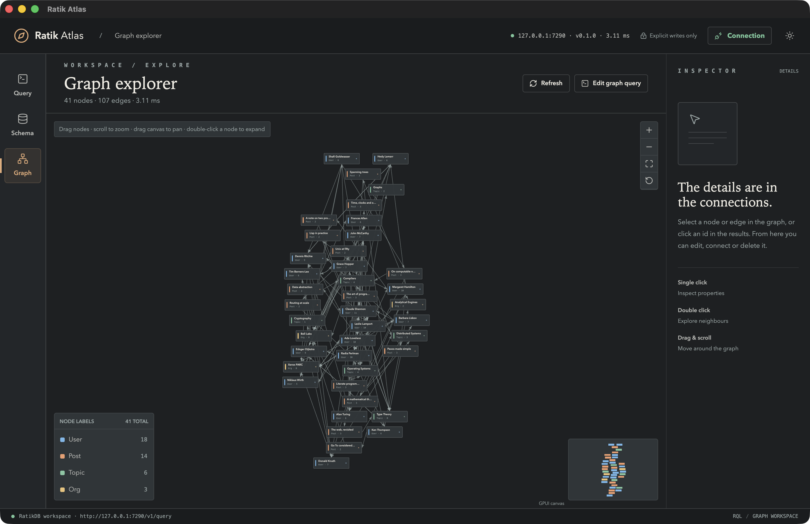

# Ratik Atlas

A native desktop graph explorer for [RatikDB](../README.md), built in Rust with
[GPUI](https://gpui.rs), the GPU-accelerated UI framework behind Zed.

Ratik Atlas is the RatikDB counterpart of [Helix Atlas](../../Database-Visualizers/helix-atlas). It keeps the
same workbench (Query, Schema and Graph workspaces, an inspector, a connection
sheet and the animated splash) and the same paper, graphite and copper design
system. Under the hood it speaks **RQL**, RatikDB's SQL-with-graph-patterns
language, and it **writes**: inserts, updates and deletes run as explicit,
atomic transactions.



## What it does

- **Splash.** A valid RQL graph query types itself into an editor window while
  the app starts.
- **Query workspace.** An RQL editor with syntax highlighting, a line gutter and
  `⌘↵` to run. It also has typed `$parameters`, an output area with Results and
  Wire format tabs, and a sidebar with the schema, examples, stored queries and
  history.
- **Graph workspace.** Connecting loads a bounded snapshot of every node and
  relationship. The canvas supports pan, scroll-zoom about the cursor and
  dragging cards. Hovering a node focuses its neighbourhood, and hovering a
  legend entry highlights that label. It also has zoom, fit and relayout
  controls, a minimap, and per-label colours that never repeat a hue.
- **Inspector.** Click a node, an edge, or an id in a table to see its
  properties, relationships with direction, neighbours and degree.
- **Schema workspace.** A searchable catalog of node types, edge types, vector
  indexes and stored queries. Each entry expands to its properties, types,
  constraints and indexes, with one-click browse, draw and insert queries.
- **Wire format.** The exact `POST /v1/query` request and the raw response, so
  nothing about the transport is hidden.
- **Light and dark themes**, with your choice remembered.

## Mutations

Writes are enabled and always explicit:

- Any `INSERT`, `UPDATE`, `DELETE`, `CREATE`, `ALTER` or `DROP` changes the run
  button to **Run mutation** and shows a banner. Nothing is written until you
  click it or press `⌘↵`.
- A script that writes is sent as **one request**, which RatikDB runs as one
  atomic transaction. If any statement fails, nothing is written.
- `DELETE` and `DROP` ask for confirmation first.
- After a commit, Atlas shows a receipt with the created, deleted and updated
  counts and any `RETURNING` rows. It then refreshes the schema, the drawn graph
  and the inspector.
- From the inspector, **Edit** loads an `UPDATE` prefilled with the element's
  current properties. **Connect** loads an `INSERT` for a new relationship.
  **Delete** removes a node with its edges, or a single edge, after
  confirmation.



## Running it

You need Rust 1.89 or newer and a running RatikDB. The Metal shader toolchain is
not required, because shaders compile at runtime.

```bash
cargo run --release --manifest-path ../Cargo.toml -p ratik-cli -- serve --memory
```

```bash
cargo run --release
```

Open **Connection** and choose **Local** with `127.0.0.1` and port `7285`. Choose
**Remote** for a full URL. Add a bearer token if the server was started with
`--token`. The connection is verified before it is saved, and Atlas reconnects
to it on the next launch.

Settings are stored in `~/Library/Application Support/Ratik Atlas/settings.json`
with `0600` permissions. A saved token is reused only for the same URL.

### Keyboard

| | |
|---|---|
| `⌘↵` | run the query or mutation |
| `⌘1` `⌘2` `⌘3` | Query, Schema, Graph |
| `⌘K` | connection |
| `⌘⇧L` | toggle theme |
| double-click a node | load its neighbourhood into the editor |

### Launch options

These are meant for demos, screenshots and smoke tests.

| Variable | Effect |
|---|---|
| `RATIK_ATLAS_URL` | connect to this server instead of the saved one |
| `RATIK_ATLAS_VIEW` | start in `query`, `schema` or `graph` |
| `RATIK_ATLAS_THEME` | `light` or `dark` |
| `RATIK_ATLAS_SKIP_SPLASH` | skip the splash screen |
| `RATIK_ATLAS_INSPECT` | inspect `node:ID` or `edge:ID` after connecting |
| `RATIK_ATLAS_RUN` | run this RQL after connecting, without the delete prompt |

## How it fits together

```
src/main.rs            window, menus, key bindings
src/app/               the application entity and its workspaces
  mod.rs               session state, requests, stale-reply guards, mutations
  shell.rs             header, navigation rail, status strip, dialog overlay
  query.rs             sidebar, editor, parameters, output tabs
  results_view.rs      tables, receipts, stats, group counts, wire format
  inspector.rs         entity detail and the Edit / Connect / Delete actions
  schema_view.rs       the schema catalog
  graph_workspace.rs   graph toolbar, states and the welcome page
  dialog.rs            connection sheet
  splash.rs            animated splash
src/graph/             force layout (Barnes–Hut), palette, the canvas
src/ui/                buttons, the hand-drawn text editor, select, tooltip
src/client.rs          blocking HTTP client, run on the background executor
src/rql.rs             statement splitting, classification, highlighting
src/results.rs         view models: graphs from rows, receipts, details
src/schema.rs          the /v1/schema catalog
src/theme.rs           design tokens for both themes
```

One entity owns the session. Every request carries the connection generation
and its own request id, so a reconnect or a newer request drops stale replies.
Network calls run on GPUI's background executor and never block the UI thread.

### How graphs are built from RQL

RatikDB returns nodes and edges as maps with `_id` and `_label` keys, and edges
also carry `_from` and `_to`. Atlas collects every element in every row, including
elements inside lists, and draws the nodes plus the edges among them. Edges whose
endpoints were not returned are counted under the canvas instead of being dropped
silently.

The server returns only the last statement of a script. A read-only script with
several statements therefore runs one statement at a time, so the default
snapshot of nodes plus relationships can be drawn together:

```sql
SELECT n FROM (n) LIMIT 400;
SELECT a, e, b FROM (a)-[e]->(b) LIMIT 2000;
```

## Tests

```bash
cargo test
cargo clippy
```

The unit tests cover statement splitting and classification, highlighting, error
decoding, schema decoding, graph extraction, view selection, layout determinism
and card separation, palette folding, literal escaping, URL normalisation and
the editor's IME underline runs.

## Screenshots

| | |
|---|---|
|  |  |
|  |  |
|  |  |
